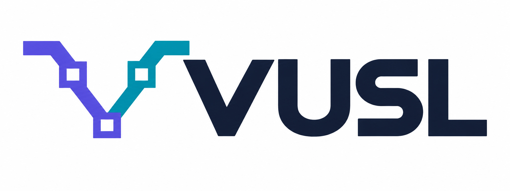

<p align="center"></p>

# VUSL — Versioned Unified Semantic Language

VUSL is a platform-neutral specification and Rust implementation for reviewing
how meaning carries between native artifacts. A mapping review identifies
the exact source and target snapshots, records what was preserved or lost,
and cites evidence for the relationship. The Rust core inspects reviews offline.

**Status:** Experimental native v0.1 source, maintained by Hypler. The Rust
packages are unpublished. Stable 1.0 release and consumer qualification are
tracked in the [implementation roadmap](docs/implementation-plan.md).

## Current implementation and historical assets

| Component | What it provides |
| --- | --- |
| [Native specification](docs/vusl-v0.1-specification.md) | A bounded mapping-review format with scoped native references, term-level fidelity and loss, and evidence-qualified relationships. |
| [Rust core](crates/vusl-core/Cargo.toml) | Offline inspection with typed results, canonical bytes, a stable document ID, and an assessment of declared required meaning. |
| [Authoring schema](schemas/vusl.mapping-review.v0.1.schema.json) | A JSON Schema 2020-12 structural check for authoring. The native inspector determines conformance. |
| [Independent coverage](crates/vusl-coverage/Cargo.toml) | Checks whether a review includes every source term required by a caller-selected policy and keeps those terms marked as required. |
| [Reference consumer](examples/reference-consumer/README.md) | Redacted CLI diagnostics, versioned semantic results, and offline examples for saved revisions, exact mapping, and multi-edge review. |

Historical RUSL/D0a artifacts are retained for [provenance](PROVENANCE.md).
The native VUSL contract and its conformance suite follow the
[accepted architectural direction](docs/vusl-native-direction.md).

## Try the reference consumer

Select Rust 1.99.1 and provision the example workspace's locked dependencies
using the [validation guide](docs/validation.md). Run from the repository root.

```bash
cargo run --locked --offline \
  --manifest-path examples/reference-consumer/Cargo.toml -- \
  --scenario saved-preview-preserved --format text
```

This example checks whether a target preview preserves the terms required for
a specific saved revision. The companion cases cover missing or downgraded
terms, stale targets, and unresolved relationships.

## Exact mapping and evidence

The opt-in [exact mapping API](docs/consumer-result-v0.1.md#opt-in-exact-mapping-result)
checks caller-selected source-to-target term pairs, exact endpoint revisions,
and the expected evidence references for each pair. Its versioned JSON result
identifies each failed obligation and distinguishes mismatches, missing or
unexpected citations, declared loss, and uncertainty. Library lending and
irrigation fixtures exercise the same rules. Native v0.1 review inputs and
existing consumer APIs remain compatible.

The [consumer result guide](docs/consumer-result-v0.1.md) also covers evidence
disagreement and chain results. Whole-chain preservation remains unresolved
until an explicit composition rule establishes it. Callers own evidence trust,
live freshness, target-loaded readback, receipts, reconciliation, and
authorization. The [offline route comparison](examples/reference-consumer/README.md#offline-route-comparison)
shows how semantic evidence can change a synthetic host’s review route.

## Documentation

- [Documentation index](docs/README.md) for the specification, implementation guides, and project records.
- [Validation guide](docs/validation.md) for toolchain setup and reproducible checks.
- [Contributing](CONTRIBUTING.md), [governance](GOVERNANCE.md), [security](SECURITY.md), and [change history](CHANGELOG.md).

Licensed under [Apache-2.0](LICENSE).
